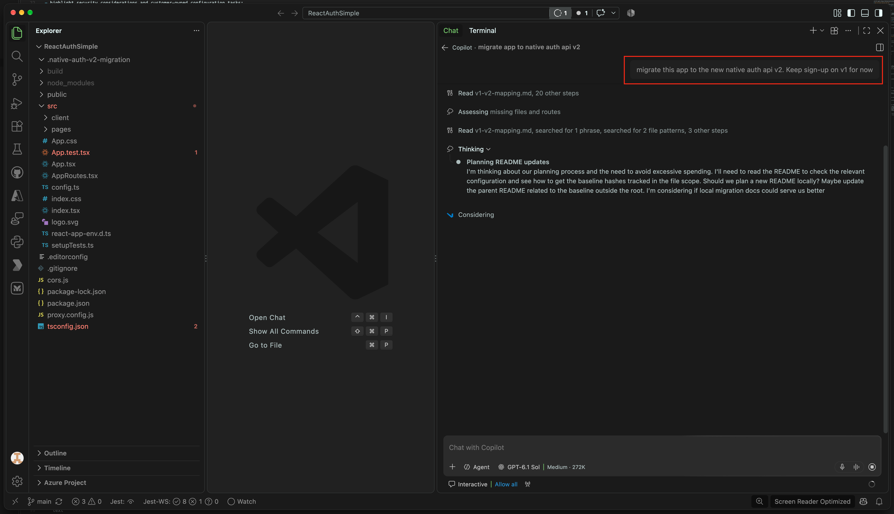
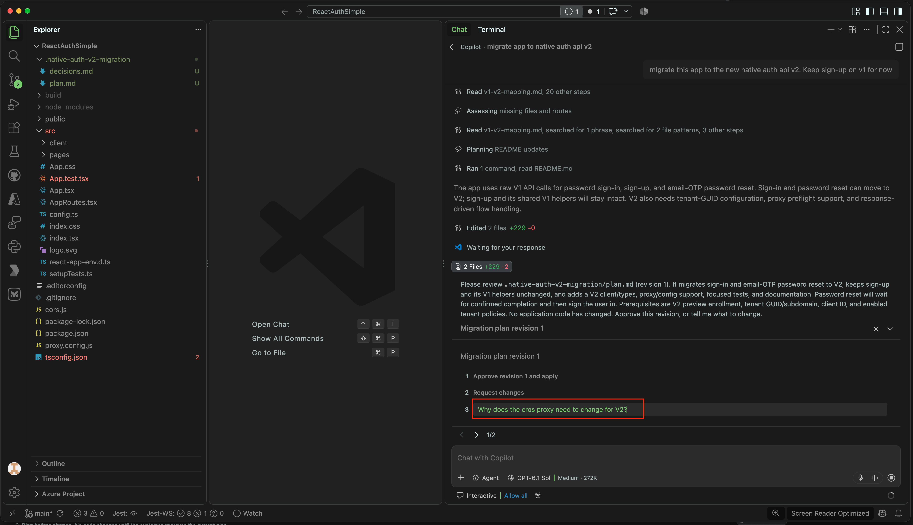
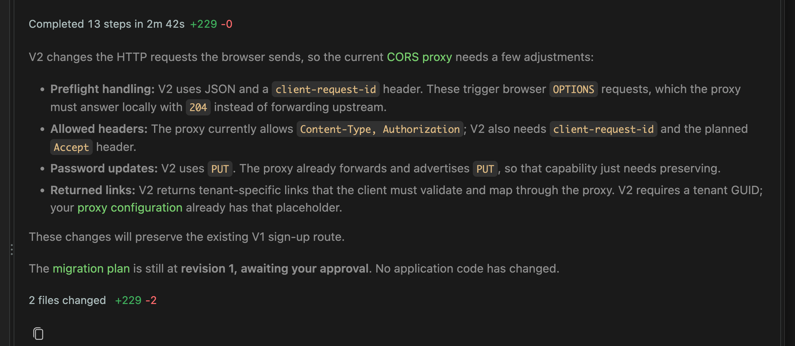
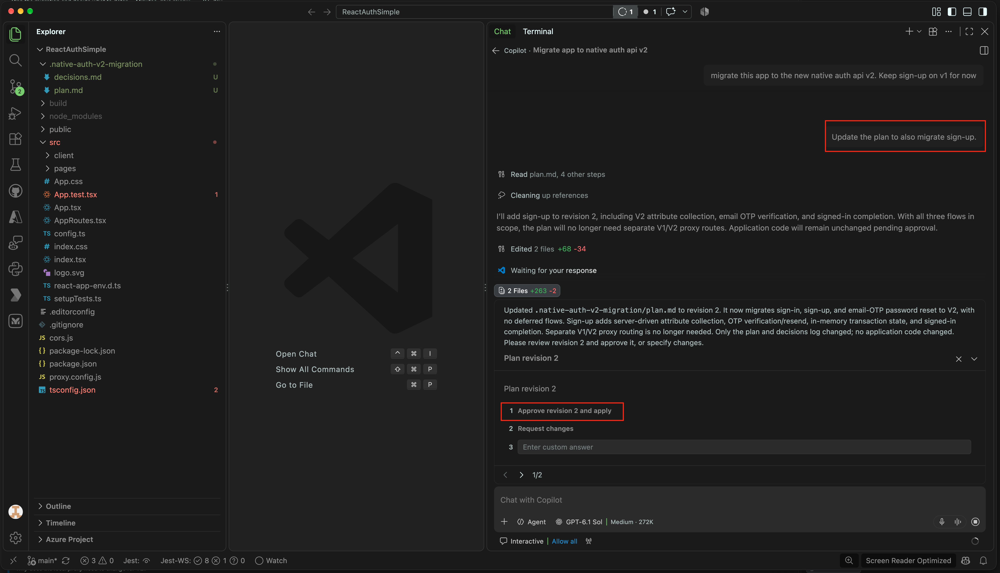
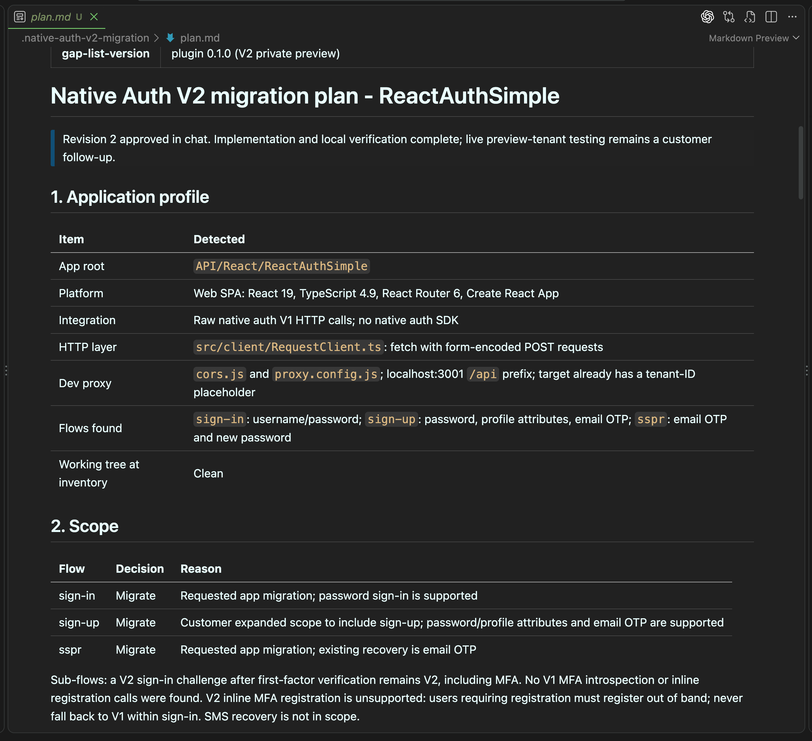
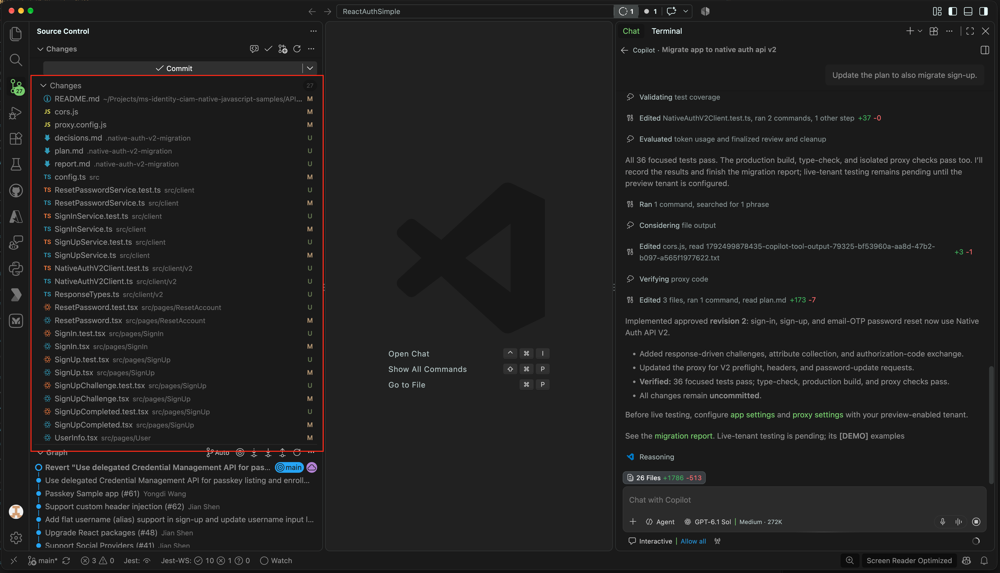
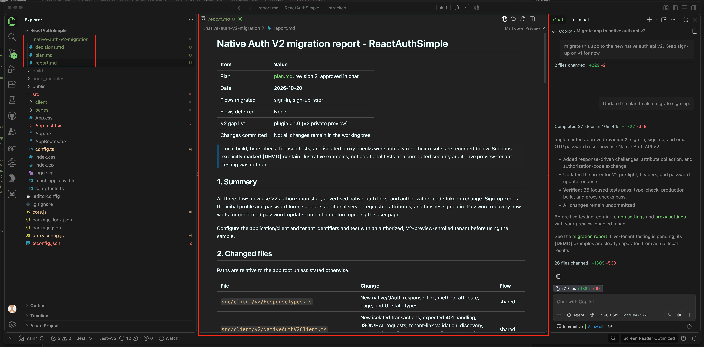

# Native Auth V2 Migration Skill

## 1. Overview

The Native Auth V2 Migration Skill helps customers move their applications
from Microsoft Entra External ID Native Auth V1 to V2 with the help of an AI
coding assistant.

Customers don't need to study every difference between V1 and V2 first. The
skill reviews their application, identifies what needs to change, proposes a
migration plan, applies the approved changes, and reports what was done and
what remains.

The skill is the first proof point for the Microsoft Entra External ID Agent
Skills toolkit. It shows how Microsoft product guidance can be delivered
directly in a customer's development workflow while the customer stays in
control.

## 2. Purpose

Native Auth V2 changes how applications run authentication journeys. A
migration can affect sign-in, sign-up, one-time passcode verification,
password reset, and multifactor authentication. Customers may find it hard
to understand the full impact or to update every affected part of their
application with confidence.

The skill is intended to:

- reduce the time and expertise needed to complete a V2 migration;
- identify the affected authentication experiences and migration risks;
- provide a clear, reviewable plan before any changes are made;
- let customers migrate one experience at a time when they need to;
- preserve the application's existing user experience where possible;
- apply Microsoft guidance consistently;
- highlight security considerations and customer-owned configuration tasks;
- provide a clear record of completed, deferred, and remaining work.

The skill supports applications that call the Native Auth API directly and
applications that use the Native Auth SDKs for iOS, Android, and JavaScript
single-page applications.

## 3. What the Customer Experience Looks Like

Customers use the skill through an AI coding assistant, such as GitHub
Copilot in VS Code, in the application they want to migrate. They describe
their goal in natural language, for example:

> Migrate this app to the new Native Auth API V2.

By default, the skill migrates every Native Auth experience in the
application. Customers can also limit the scope, for example by keeping
sign-up on V1 for now.

The experience follows four stages.

### 3.1 Understand the application

The skill reviews the application and identifies:

- the application type;
- how Native Auth is currently used;
- the authentication experiences affected by the migration;
- the areas of the application likely to require changes;
- important assumptions, risks, or capabilities not yet available in V2.

### 3.2 Create a reviewable plan

The skill creates a migration plan before changing the application. The plan
explains the proposed scope, the affected experiences, what will change,
what will be deferred, and how the result should be validated.

The customer can refine the plan in natural language, for example:

> Update the plan to also migrate sign-up.

They can also ask questions at any point. Every change to the plan creates a
new revision that needs the customer's approval. The approved plan becomes
the agreed scope; the skill doesn't expand beyond it.

### 3.3 Apply the approved migration

After the customer approves the plan, the skill applies the migration within
the agreed scope. It keeps the existing user experience and code style where
practical, and leaves deferred experiences unchanged. Changes are never
committed automatically: the customer reviews them like any other code
change.

### 3.4 Validate and report

The skill reviews the result and provides a final report. The report
distinguishes between:

- work completed by the skill;
- work intentionally deferred;
- checks completed;
- validation the customer must still perform;
- security findings for the customer to review;
- remaining risks and recommended next steps.

Progress is saved in the customer's project, so a migration can be resumed
in a later session.

## 4. Expected Customer Outcomes

At the end of a successful migration, the customer should have:

1. A clear understanding of where Native Auth V1 was used.
2. A reviewed migration plan with explicit scope and assumptions.
3. An application updated to Native Auth V2 within that approved scope,
   ready for code review.
4. A summary of migrated and deferred authentication experiences.
5. A record of validation completed and manual validation still required.
6. A security-focused review of the migration outcome.
7. Clear risks, customer responsibilities, and recommended next steps.

## 5. How Customers Get the Skill

The skill ships in the Microsoft Entra External ID Agent Skills toolkit.
The toolkit is delivered as a **plugin**: a single package that customers
install into their AI coding assistant, containing this skill and future
External ID skills. Customers install the plugin once and get every skill in
it. They discover the toolkit on Microsoft Learn, install the plugin from
their coding assistant's marketplace or from GitHub, and then ask their
assistant for the migration in their own project.

### 5.1 GitHub repository

A dedicated public GitHub repository will host the toolkit plugin and its
documentation. Customers can install the plugin directly from the
repository in assistants that support it, or install individual skills with
the open-source [Skills CLI](https://skills.sh) (`npx skills add <repository>`).

### 5.2 Microsoft Learn

A dedicated Microsoft Learn page will introduce the toolkit, list the
skills in its plugin, and explain how customers can use them to adopt External
ID services in their own products. Native Auth V2 migration guidance on
Learn will also point customers to the skill.

### 5.3 Coding assistant marketplaces

The toolkit plugin will be published to the marketplaces of popular coding
assistants, so customers can install it in one step from tools they already
use:

| Marketplace | Coding assistant |
| --- | --- |
| [Awesome Copilot](https://awesome-copilot.github.com/plugins/) | GitHub Copilot in VS Code and Copilot CLI |
| [Claude plugin directory](https://claude.com/plugins) | Claude Code |
| [ChatGPT and Codex plugin directory](https://learn.chatgpt.com/docs/plugins) | OpenAI Codex |
| [Cursor Marketplace](https://cursor.com/marketplace) | Cursor |
| [skills.sh](https://skills.sh) | Individual skills, for any assistant the Skills CLI supports |

Each marketplace has its own submission and review process, so listings are
planned and depend on each marketplace's approval.

## 6. Product Value

For customers, the skill turns days of specialized work into a guided
conversation, reducing effort and uncertainty while keeping full
transparency and control. For Microsoft, it creates a repeatable way to
deliver current product guidance in the customer's workflow, improve
consistency, accelerate V2 adoption, and reduce issues caused by incomplete
or outdated migration approaches.

The skill also establishes reusable patterns for future External ID Agent
Skills: plan before applying, customer-approved scope, shared security
guidance, validation, and outcome reporting.

---

## Appendix A: Demo Walkthrough

This walkthrough shows the skill migrating a Microsoft React sample
application that uses Native Auth V1 for sign-in, sign-up, and password
reset, using GitHub Copilot in VS Code.

**The complete migration took about 20 minutes.** We estimate the same work
at 3–4 days for a developer doing it by hand:

| Task | With the skill | By hand (estimate) |
| --- | --- | --- |
| Learn V2 and find the affected code | Minutes | ~1 day |
| Plan the migration and decide what to defer | Minutes, plus review | ~0.5 day |
| Update sign-in, sign-up, and password reset | Minutes | ~1–1.5 days |
| Update development setup and test | Minutes, plus testing | ~0.5–1 day |
| **Total** | **About 20 minutes** | **About 3–4 days** |

*The manual estimate assumes a developer new to V2. Actual effort varies
with application size and complexity.*

### A.1 Start the migration

The developer asks for the migration in natural language. The skill reviews
the application, writes a migration plan and a decisions log in the project,
and asks for approval without changing any code.

> Migrate this app to the new Native Auth API V2. Keep sign-up on V1 for now.

By default, the skill migrates every Native Auth experience it finds in the
application, so a simple "Migrate this app to the new Native Auth API V2" is
enough. This demo keeps sign-up on V1 only so that section A.3 can show how the
plan is updated.

### A.2 Ask a side question

While the plan waits for approval, the developer asks a question. The skill
answers it without changing the plan, then reminds the developer that the
plan is still waiting for approval.

> Why does the CORS proxy need to change for V2?

### A.3 Update and approve the plan

The developer adds sign-up to the scope. The skill updates the plan to
revision 2, records the change in the decisions log, and asks for approval
again. Code changes start only after the developer approves this revision.

> Update the plan to also migrate sign-up.

The plan is a document in the customer's project. It describes the
application, the scope for each experience, and the reason for each
decision.

### A.4 Code complete

The skill migrates sign-in, sign-up, and password reset, keeps the existing
screens, and adds tests for the migrated experiences. In the demo it changed
26 files in under 17 minutes, and all 36 tests passed. Every change is left
uncommitted for the developer to review.

### A.5 Final report

The skill finishes with a report in the project. The report includes:

- **Summary:** the approved plan revision, migrated and deferred
  experiences, and confirmation that nothing was committed.
- **Changed files:** each file changed, what changed, and which experience
  it belongs to.
- **Coexistence:** which experiences remain on V1, if any, and how they keep
  working.
- **Validation results:** the build, type-check, and test results, plus the
  checks the customer still needs to run against a test tenant.
- **Security review:** issues the skill found and fixed in its own changes,
  plus existing issues for the customer to review.
- **Manual follow-up:** tenant and configuration tasks the customer owns.
- **Next phase:** deferred experiences and what will unblock them.
- **Rollback:** how to undo the changes.

